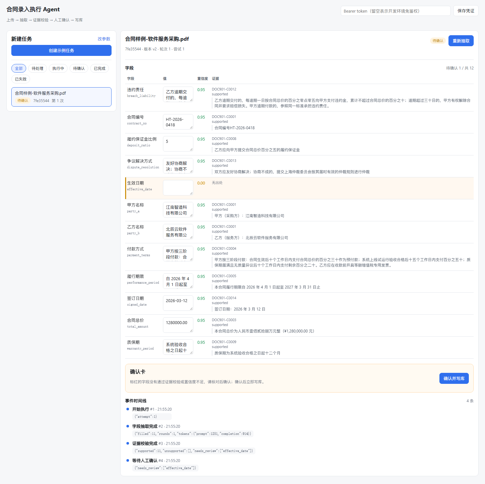

# 合同录入执行 Agent

上传合同 PDF → 自动抽取字段 → 低置信字段标红 → 人工确认 → 写库。

重点不在「模型能不能抽字段」，而在**把 Agent 编排放进一套工程化的后端底座**：任务调度、状态机、幂等、可观测、完整 API 契约。

- 仓库：<https://github.com/ANSN1221/contract-entry-Agent>
- 文件名看不懂：[docs/文件名对照.md](docs/文件名对照.md)
- 目标岗位：大模型应用开发（偏后端）
- 执行窗口：2026-11-18 — 2026-12-09，共 16 个工作日

---

## 快速开始

```bash
# 1. 同级目录先放项目一（检索与引用校验能力）
git clone https://github.com/ANSN1221/Contract-qa-RAG.git ../Contract-qa-RAG

# 2. 装依赖（含检索能力）
uv sync --extra dev --extra rag

# 3. 配环境变量
cp .env.example .env   # 填 DEEPSEEK_API_KEY / SILICONFLOW_API_KEY

# 4. 起服务
uv run uvicorn app.main:app --reload --port 8000

# 5. 验收
curl http://127.0.0.1:8000/healthz
# {"status":"ok","service":"contract-entry-agent","version":"0.1.0","env":"dev"}
```

文档：<http://127.0.0.1:8000/docs> · OpenAPI：<http://127.0.0.1:8000/openapi.json>

只想跑骨架、不接检索（无 `contract-qa` 时）：

```bash
uv sync --extra dev
```

## 常用命令

| 用途 | 命令 |
| --- | --- |
| 启动 | `uv run uvicorn app.main:app --reload` |
| 签发短期 token | `uv run python scripts/issue_token.py --subject dev --ttl 3600` |
| 生成合成合同样例 | `uv run python scripts/make_sample_contract.py` |
| 跑真实模型链路测试 | `RUN_LIVE_LLM=1 uv run pytest tests/test_extract_live.py` |
| 跑评测 | `uv run python scripts/evaluate.py` |
| **本机演示（一条命令）** | `uv run python scripts/demo.py` |
| 演示前清空数据 | `uv run python scripts/demo.py --fresh` |
| 前端开发 | `cd frontend && npm run dev`（代理到 8000） |
| 前端构建 | `cd frontend && npm run build`（产物由后端托管） |
| 建库 / 升级到最新 | `uv run alembic upgrade head` |
| 改完模型生成迁移 | `uv run alembic revision --autogenerate -m "描述"` |
| 回退一步 | `uv run alembic downgrade -1` |
| 查看当前版本 | `uv run alembic current` |
| 测试 | `uv run pytest` |
| 静态检查 | `uv run ruff check .` |
| 格式化 | `uv run ruff format .` |

## 目录结构

```
app/
├── main.py            # 应用工厂：装配顺序 日志 → 错误体 → 中间件 → 路由
├── config.py          # env 聚合（pydantic-settings），业务代码不读 os.environ
├── errors.py          # 统一错误体 + 异常处理器
├── middleware.py      # request_id 贯穿 / 访问日志 / 滑窗限流
├── log.py             # structlog 配置
├── models.py          # Task / TaskTransition / TaskField，12 字段清单
├── store.py           # 引擎、会话、SQLite PRAGMA + get_session 请求级会话依赖
├── repository.py      # 任务仓储层：接口层不直接写 SQL，业务失败翻译成 AppError
├── schemas.py         # 接口契约：请求/响应 pydantic 模型，与数据库模型分开演化
├── state_machine.py   # 白名单迁移 + 乐观锁 + 审计
├── adapters/
│   └── rag.py         # contract-qa 适配层（双路召回 + 引用校验的边界）
└── api/
    └── v1/
        ├── __init__.py  # v1 路由汇总
        ├── health.py    # /healthz /readyz
        └── tasks.py     # 任务 CRUD + 状态迁移 + 审计时间线
migrations/            # Alembic 迁移脚本（versions/ 下按时间累积）
alembic.ini            # 迁移工具配置（连接串由 env.py 从 config 注入）
docs/                  # 文件名中英对照等说明文档
tests/                 # 状态机单测 / 模型约束 / API 契约（随排期补）
```

## 架构

```
                    ┌──────────────────────────────┐
  浏览器 ──HTTP──→  │  FastAPI                     │
   (React)          │  ├─ 鉴权（Bearer / 签名 token）│
                    │  ├─ 限流 + request_id         │
                    │  └─ /api/v1 路由组            │
                    └──────┬───────────────┬───────┘
                           │               │
                  写任务/查详情        提交确认
                           │               │
                    ┌──────▼───────────────▼───────┐
                    │  Repository（乐观锁 + 审计）   │
                    └──────────────┬───────────────┘
                                   │ 状态迁移 + 事件同事务
                    ┌──────────────▼───────────────┐
                    │  SQLite / PostgreSQL          │
                    │  task · task_field            │
                    │  task_transition · event      │
                    └──────────────▲───────────────┘
                                   │
   POST /run ──→ 后台 Runner（asyncio 队列，超时/死信）
                                   │
                    ┌──────────────┴───────────────┐
                    │  LangGraph 主图               │
                    │  plan→retrieve→extract→       │
                    │  verify ⇄ retry→decide        │
                    └──────┬──────────────┬────────┘
                           │              │
                  条款检索（项目一）    抽取/校验（DeepSeek）
                  双路召回 + 重排      强制引用 + 三态结论
```

数据流只往一个方向走：**模型产出草稿，人签字，才写库**。Runner 与请求解耦，浏览器关掉任务照跑；状态全在库里，进程重启不丢任务（checkpointer 存断点）。

## 本机演示

```bash
uv run python scripts/demo.py
```

启动器做四件事，任何一项缺失都会打印该跑什么命令：

1. 环境自检（两个密钥、项目一索引、前端产物）
2. 库没迁移就自动 `alembic upgrade head`
3. 签发 12 小时 token 并打印（粘到页面右上角）
4. 起服务：前端与 API 同端口

| 参数 | 作用 |
| --- | --- |
| `--fresh` | 清空本地 SQLite 演示库，从零开始 |
| `--no-auth` | 关闭鉴权，演示时不用粘 token |
| `--port 8080` | 换端口 |
| `--ttl-hours 2` | token 有效期 |

演示分镜与讲解要点见 [docs/演示脚本.md](docs/演示脚本.md)。

## 界面

构建产物存在时由后端直接托管，部署只需要一个进程、一个端口（`uvicorn app.main:app`）。



三个区域：左侧任务列表与状态筛选，中间字段表格（低置信/证据不通过的行标黄），下方确认卡与事件时间线。

- **事件时间线走 SSE**：执行中实时追加，不用轮询
- **确认卡直接改字段**：只提交改动过的值，未改动字段一并视为人工确认
- **凭证存 localStorage**：内部工具；真要公网部署应换 httpOnly cookie

## 状态机

```
pending ──→ running ──→ await_confirm ──→ done
              │  │            │
              │  └────────────┴──→ blocked
              └──→ failed
```

| 迁移 | 触发场景 |
| --- | --- |
| `pending → running` | 调度器领取任务 |
| `running → await_confirm` | 抽取完成，存在低置信字段 |
| `running → done` | 无可疑字段，直接写库 |
| `running → blocked` | 缺关键信息，转人工 |
| `running → failed` | 重试用尽或不可恢复错误 |
| `await_confirm → done` | 人工确认后写库 |
| `await_confirm → running` | 用户要求重新抽取 |
| `await_confirm → blocked` | 确认超时 |

`done` / `blocked` / `failed` 是吸收态，没有出边；针对终态的任何操作返回 409。
每次迁移写一条 `TaskTransition`（谁、从哪到哪、原因、时间、request_id），形成审计链。
并发用 `Task.version` 做 CAS，抢不到的一方抛 `ConcurrentModification`，不覆盖别人的写入。

## 统一错误体

所有异常出口只有一种形状：

```json
{"error": {"code": "NOT_FOUND", "message": "资源不存在", "detail": null, "request_id": "a1b2c3d4e5f6"}}
```

- HTTP 语义化：400 / 401 / 403 / 404 / 409 / 429 / 500
- 校验失败统一 400 `VALIDATION_ERROR`（不用 FastAPI 默认 422，契约里只有一个参数不合法出口）
- `request_id` 同时回写在响应头 `X-Request-ID`，客户端可凭它反查整条日志链；请求自带该头且长度合法时原样透传

## 当前进度

| 日期 | 交付物 | 状态 |
| --- | --- | --- |
| 11-18 | 仓库骨架 + uv 装配 + 空 FastAPI + 统一错误体 | 已完成 |
| 11-19 ~ 11-20 | 数据模型 + 迁移 + 状态机 + 单测 | 已完成（提前） |
| 11-23 ~ 11-24 | 仓储层 + 任务 CRUD API + 集成测试 | 已完成（提前，11-19） |
| 11-25 ~ 11-27 | 工具与主链路（条款检索 / 证据校验 / 抽取提示词 / 编排） | 全部完成：检索 + 抽取 + 校验 + 主图 + 执行器 |
| 11-30 | 幂等键 + confirm_token + 乐观锁 | 已完成（幂等键在创建、token 在确认、乐观锁在两处） |
| 12-01 | SSE 事件通道 + 断点续跑 | 已完成 |
| 12-02 ~ 12-04 | 异常分支细化 + 指标 + 评测 | 已完成 |
| 12-07 | 前端薄壳 + 部署 | 已完成（本机单进程单端口） |
| 12-08 ~ 12-09 | README + 演示脚本 + 录屏 | README 与演示脚本已完成，录屏待录 |
| 后续 | 见项目计划书第八章 | — |

已完成：`uv` 工程装配、路径依赖接入、应用工厂、统一错误体、request_id 中间件、限流、结构化日志、`/healthz` `/readyz`、SQLModel 四张表、Alembic 迁移、状态机白名单 + 乐观锁 + 审计链、任务仓储层、任务 CRUD API、Bearer 鉴权、工具白名单与参数强校验、条款检索工具、12 字段抽取与证据校验、LangGraph 主图、后台执行器、一次性 confirm_token 确认写库、SSE 事件流、SQLite 持久化断点续跑、Prometheus 指标、评测脚本、死信上限、React 前端（列表 / 字段 / 确认卡 / SSE 时间线）、真实语料（11 份 780 条条款）多文档作用域、244 条测试。

## 鉴权

三档策略，按配置自动升降；探针 `/healthz` `/readyz` 永远公开，否则部署平台探活会全挂。

| 配置 | 行为 |
| --- | --- |
| 填 `API_TOKEN_SECRET` | 只认短期签名 token（`Authorization: Bearer <token>`） |
| 只填 `API_TOKEN` | 只认这个长期 token，可走 `Authorization` 或 `X-API-Key` |
| 都不填 + dev/test | 放行，日志留 `auth_disabled` 痕迹 |
| 都不填 + prod | 全部拒绝（fail closed），避免忘配凭证就裸奔 |

```bash
# 1. 生成密钥写进 .env
python -c "import secrets; print(secrets.token_urlsafe(32))"

# 2. 签发有效期 1 小时的 token
uv run python scripts/issue_token.py --subject dev --ttl 3600

# 3. 调用
curl -H "Authorization: Bearer <token>" http://127.0.0.1:8000/api/v1/tasks
```

token 是 `v1.<payload>.<签名>` 三段式，HS256 自签，不引 JWT 库：只有「签发 / 校验 / 过期」三个需求，用不到算法白名单、密钥轮换那套。校验用 `hmac.compare_digest` 走常量时间比较，失败一律 401 且不透露错在哪一步（签名错和过期给不同 message，但都不含内部细节）。`/docs` 上有 Authorize 按钮可直接填。

## 任务 API

| 端点 | 说明 |
| --- | --- |
| `POST /api/v1/tasks` | 创建任务（JSON 元数据）；带 `Idempotency-Key` 头重复提交返回同一任务 |
| `GET /api/v1/tasks` | 分页列表：`offset`/`limit`（默认 0/20，上限 100）+ `status` 筛选，信封 `{items, total, offset, limit}` |
| `GET /api/v1/tasks/{id}` | 详情 + 状态迁移审计时间线 |
| `POST /api/v1/tasks/{id}/transitions` | 状态迁移：`{to_status, version, reason?, actor?}`；版本不符 409 `CONCURRENT_MODIFICATION`，非法迁移 409 `INVALID_TRANSITION` |
| `POST /api/v1/tasks/{id}/run` | 执行任务（检索 → 抽取 → 校验 → 待确认）；`?wait=true` 同步等结果，`?resume=true` 从断点续跑 |
| `POST /api/v1/tasks/{id}/confirm` | 人工确认：带一次性 `confirm_token` + 可选的人工修正字段，成功后转 `done` 并写库；二次提交 409 |
| `GET /api/v1/tasks/{id}/events` | SSE 事件流：`Last-Event-ID` 断线补发，`?follow=false` 只回放已有事件，`?token=` 给不能设请求头的 `EventSource` 用 |
| `GET /metrics` | Prometheus 文本指标（免鉴权，与探针同理） |
| `GET /api/v1/metrics` | 指标快照 JSON：任务分布、成功率、分位耗时、字段校验分布 |

## 执行链路

```
POST /run
   ↓
runner 领取（pending→running，乐观锁 + 审计）
   ↓
LangGraph 主图：plan → retrieve → extract → verify ─┬→ decide
                    ↑                              │
                    └──── retry（3 个以上字段校验失败才重抽，最多 2 轮）
   ↓
runner 落库：字段结果整体覆盖写入 task_field
   ↓
await_confirm（有低置信 / 未验证 / 校验不通过字段）  或  done（全部字段高置信且证据通过）
   ↓（await_confirm 时发放一次性 confirm_token）
POST /confirm（带 token，可附人工修正）
   ↓
done：字段落库，token 作废，审计记录 human:<subject>
```

全过程写 `event` 表，前端订阅 `GET /tasks/{id}/events` 就能画时间线：

```
id=1  task.running
id=2  extraction.done      {"filled":11,"rounds":1,"tokens":{...}}
id=3  verification.done    {"supported":11,"unsupported":[],"needs_review":["effective_date"]}
id=4  task.await_confirm
```

确认接口四道闸门，按「越便宜越先」排：任务存在 → 状态是 `await_confirm` → token 对且未用过 → 版本号对。任何一道不过都返回 409/403/404，不会写脏数据。

可靠性边界：单任务超时 120s → `failed`（`TIMEOUT`）；图抛异常 → `failed`（`RUNNER_ERROR`）；抽不到任何字段 → `failed`（`EXTRACT_EMPTY`）；终态任务再执行 → 409 `TASK_TERMINAL`。

实测（合成合同，真实模型 + 真实索引）：

```
POST /run?wait=true
→ status=await_confirm  rounds=1  tokens=1251+910  confirm_token 已发放
→ review_keys=["effective_date"]

POST /confirm {confirm_token, fields:[{field_key:"effective_date", value:"2026-04-01"}]}
→ status=done  version=3
→ 审计链：pending→running→await_confirm→done
→ 人工修正落库：value=2026-04-01, verified=true, verify_note=human_confirmed
→ 二次提交同 token：409 TASK_NOT_AWAIT_CONFIRM
```

## 字段抽取与证据校验

一条链路：**多组关键词召回条款 → 一次模型调用抽 12 个字段 → 逐字段核证据**。

| 环节 | 关键约束 |
| --- | --- |
| 召回 | 多组查询去重后取前 16 条，控制上下文体积 |
| 抽取 | 每个非空字段必须给 `clause_id` + 原文 `quote`，否则置信度压到 0.3 并标红 |
| 兜底 | 未知字段丢弃、置信度越界夹紧、出处不在召回范围内则清空证据 |
| 校验 | 规则层（归一化后包含判断）优先，未命中再交模型判定；判不了返回 `unverified` 而非通过 |

实测（合成合同 `DOC901`，13 条召回）：

```
填充 11/12    低置信 1    token 1251+914
total_amount        1280000.00              0.95  DOC901-C0003  → supported (rule)
deposit_ratio       5                       0.95  DOC901-C0008  → supported (llm，原文「百分之五」)
party_a             江南智造科技有限公司        0.95  DOC901-C0001  → supported (rule)
effective_date      -                       0.00  -             → 待确认（合同里确实没写生效日期）
```

关键点：`effective_date` 没抽出来是**正确行为**——合同只写了签订日期与履行期限起点，
模型没有拿「2026-04-01 开始履行」去猜生效日期。这一条比抽对 11 个字段更能说明约束生效。

## 事件流与断点续跑

**事件表与状态迁移分开**：迁移是状态机的账（谁把状态改成什么），事件是给前端看的叙事（检索完成、抽取完成、校验结论）。后者不进状态机，但时间线要显示，所以单独一张 `event` 表，自增 `id` 直接当 SSE 的 `Last-Event-ID` 用。

| 细节 | 处理 |
| --- | --- |
| 断线重连 | 浏览器 `EventSource` 自动带 `Last-Event-ID`，头优先于 `?since=` |
| 终态收尾 | 任务到 done/failed 且事件读完，流主动结束，不留空连接 |
| 心跳 | 每 15 秒一个注释帧（`: ping`），防代理掐断空闲连接 |
| 代理缓冲 | 响应头带 `X-Accel-Buffering: no`，否则 nginx 会攒着一起发 |
| 鉴权 | `EventSource` 不能设请求头，仅 SSE 端点额外接受 `?token=` |

**断点续跑**用 `AsyncSqliteSaver`，`thread_id` 就是 `task_id`。为什么必须是异步版：LangGraph 的同步 `SqliteSaver` 不支持 `ainvoke`，会直接抛 `NotImplementedError`。连接随应用生命周期开关，测试里换连接即可模拟「进程被 kill 再起来」，图会从最后一个成功的节点继续，已完成节点不重跑。

## 可观测与评测

**指标从数据库聚合，不用进程内计数器**：进程重启数字归零、多 worker 各算各的，排查时对不上账。任务表/字段表/事件表本身就是事实来源，聚合只是换个视角重读一遍。

| 指标 | 含义 |
| --- | --- |
| `contract_tasks_total` / `_status{status}` | 任务总量与状态分布 |
| `contract_tasks_success_rate` | 成功率 = done / (done + failed + blocked) |
| `contract_task_duration_avg_seconds` / `_p95_seconds` | 端到端耗时均值与 P95 |
| `contract_fields_needs_review` / `_verified` / `_rejected` | 字段证据链健康度 |
| `contract_extraction_retries_total` | 重抽次数，飙升说明提示词在退化 |

**评测脚本**（`uv run python scripts/evaluate.py`）分三个口径算，因为失败原因完全不同：

| 指标 | 口径 | 合成合同 DOC901 | 真实合同 DOC012 |
| --- | --- | --- | --- |
| 字段准确率 | 12 字段与人工标注比对 | 12/12 = 100% | **11/12 = 91.7%** |
| 引用可核对率 | 抽到值的字段带出处且证据通过 | 100% | 100% |
| 不可答正确率 | 语料里确实没答案的问题，模型不许编 | 8/8 = 100% | 6/6 = 100% |
| 成本 | 单份合同 | 2165 token / 8.8s | 2709 token / 8.4s |
| 待人工确认 | 低置信 / 未验证 / 校验不过 | 1 个 | 4 个 |

DOC012 唯一没抽对的是 `warranty_period`：合同写的是「缺陷责任期阶段监理 365 日历天」，
模型没把它等同于「质保期」。这类**术语映射**是该类系统的典型失败模式，靠增加字段别名解决，
不是靠调提示词硬怼。

匹配规则本身有测试（`tests/test_eval_matcher.py`）：中文数字、百分比、日期格式差异必须判对，真实错配必须判错——规则错了，分数就是假的。

> 口径说明与局限：
> - 语料 16 份（15 份公开采购合同 + 1 份合成样例），5 份是扫描件无法抽文本，实际可检索 11 份、780 条条款。
> - 深度标注只有 2 份（合成 1 份 + 真实 1 份），样本量小，数字是**方向性证据**而不是统计结论。
> - 评测脚本支持 `--gold` 指定标准答案文件，扩标注只需加 JSON，不动代码。

## 设计约定
- **状态机**：白名单表 `ALLOWED_TRANSITIONS` 是唯一判定源，非法迁移抛 `InvalidTransition`；迁移与审计写在同一事务，中途失败不留半条记录。
- **状态存字符串不存枚举**：跨 SQLite / PostgreSQL 更省事，合法性由状态机保证，数据库只负责存。
- **乐观锁**：`Task.version` 做 CAS（`WHERE version = ?`），并发改同一条任务时后到者失败而非覆盖。
- **幂等**：上传带 `Idempotency-Key`，重复返回同一 task；写库靠唯一约束；确认用一次性 `confirm_token`，二次提交 409。
- **状态与连接解耦**：后台 runner 持有任务状态，浏览器关闭不影响任务推进。
- **依赖隔离**：`contract_qa` 的内部数据结构不进入业务层，一律经 `app/adapters/` 转换成本项目类型。
- **鉴权挂在路由组上**：`include_router(..., dependencies=[Depends(require_principal)])`，一次挂载覆盖所有 v1 接口，新增路由不用逐个记得加。
- **工具白名单**：`app/tools/` 里 `TOOL_WHITELIST` 之外的工具名一律拒绝；每个工具一个 pydantic 参数模型，`extra="forbid"`，模型多塞字段直接报错而不是猜。

## 验收清单

| 能力 | 验证方式 |
| --- | --- |
| 抽取 12 字段并带出处 | `scripts/evaluate.py` → 合成 12/12、真实 DOC012 11/12，引用均 100% |
| 不编造（不可答问题） | 合成 8/8、真实 6/6；合同没写编号/生效日期时输出 null 而非猜测 |
| 证据链可核对 | 每个字段 `clause_id` + `quote` + `verify_note` 三件套，规则层优先、模型兜底 |
| 人工确认幂等 | 一次性 `confirm_token`，二次提交 409 `CONFIRM_ALREADY_USED` / `TASK_NOT_AWAIT_CONFIRM` |
| 并发安全 | `Task.version` 乐观锁；陈旧版本 409 `CONCURRENT_MODIFICATION` |
| 状态机合法性 | 白名单迁移，非法迁移 409 `INVALID_TRANSITION`；审计链可查 |
| 执行可靠性 | 120s 超时、3 次上限进死信、异常转 `RUNNER_ERROR` |
| 断点续跑 | 换连接模拟重启，图从最后成功节点继续 |
| 实时进度 | SSE 事件流，`Last-Event-ID` 断线补发 |
| 可观测 | `/metrics` Prometheus 文本 + `/api/v1/metrics` JSON |
| 鉴权 | 签名 token 过期/篡改/错密钥全部 401；生产未配置凭证则 fail closed |
| 回归 | `uv run pytest` → 238 条 |

## 与项目一的关系

[Contract-qa-RAG](https://github.com/ANSN1221/Contract-qa-RAG) 提供条款级检索（BM25 + 向量，RRF 融合）与引用校验，本项目通过 path 依赖接入：

```toml
[tool.uv.sources]
contract-qa-agent = { path = "../Contract-qa-RAG", editable = true }
```

发行名 `contract-qa-agent`，导入名 `contract_qa`。缺包时 `app/adapters/rag.py` 抛出带安装指引的 `RagUnavailable`，而不是 `ImportError`。

## 明确不做

OCR 全流程 · 多租户权限 · 移动端 · 分布式队列（Celery / Kafka）· 法律意见生成。
